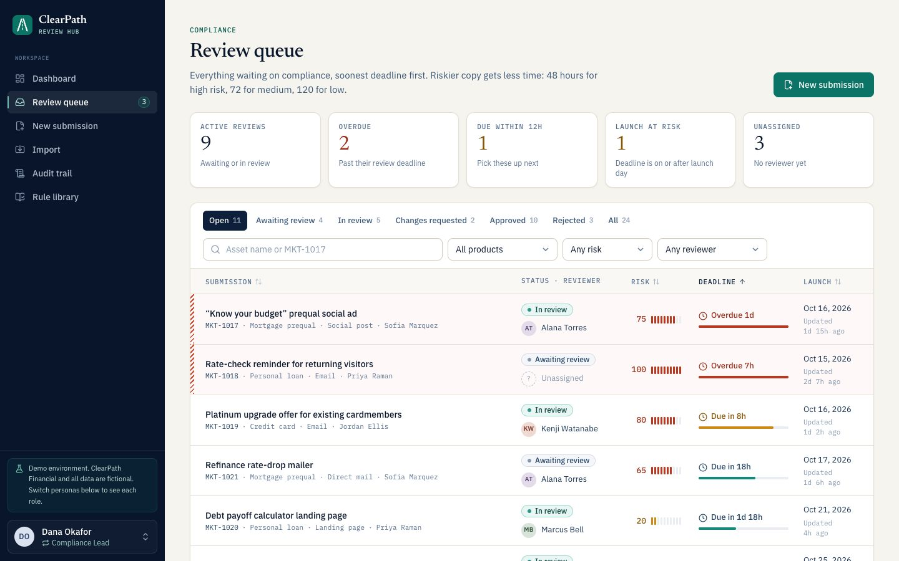
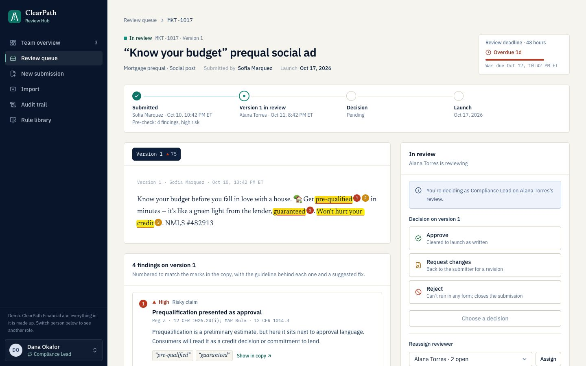
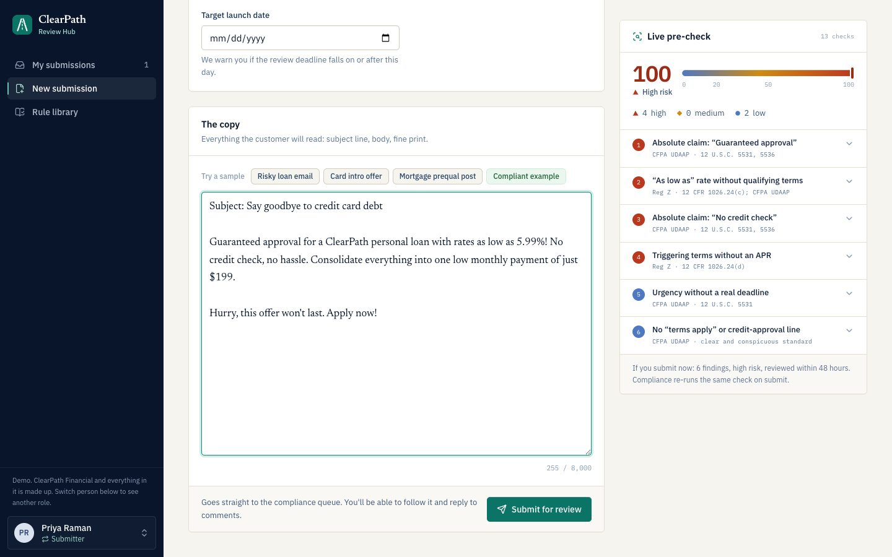
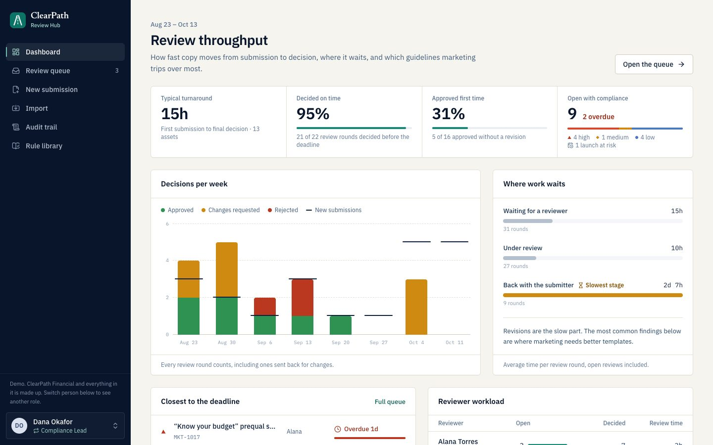
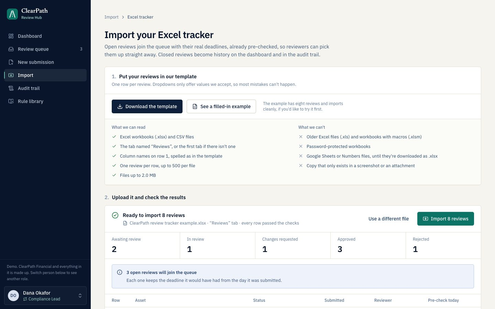
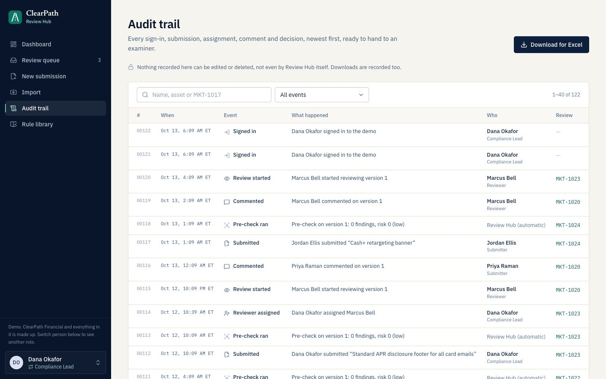
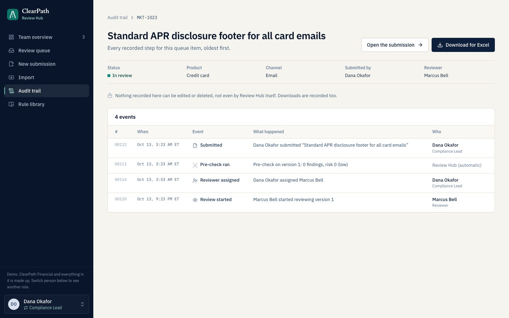
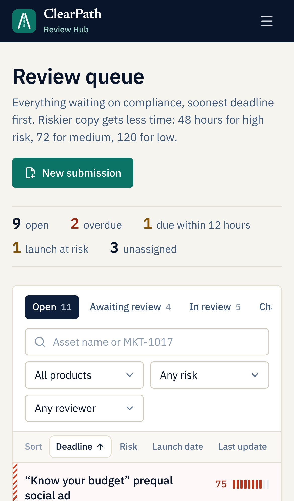
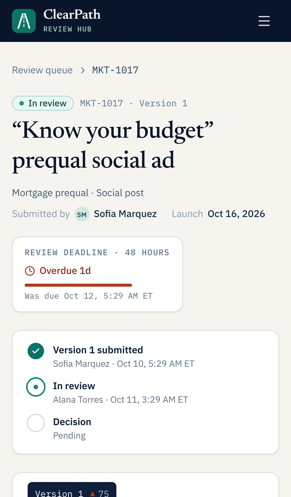

# ClearPath Review Hub

The marketing-compliance review desk for ClearPath Financial. It replaces the
Excel tracker and the email threads that marketing and compliance use today,
so more campaigns get reviewed, on time, with less back-and-forth.

> ClearPath Financial, its people and its data are fictional. This is a working
> demo: anyone with the link can sign in as one of seven sample employees.

**Live demo:** [clearpath-review-hub.vercel.app](https://clearpath-review-hub.vercel.app) ·
**Code:** [github.com/Sgagneja/clearpath-review-hub](https://github.com/Sgagneja/clearpath-review-hub)



**On this page:** [Why it exists](#why-it-exists) · [Try it](#try-it) · [The screens](#the-screens) ·
[How a submission moves](#how-a-submission-moves) · [Worked examples, end to end](#worked-examples-end-to-end) ·
[The pre-check rules](#the-pre-check-rules) · [Scores and deadlines](#scores-and-deadlines) ·
[Who can do what](#who-can-do-what) · [The data it expects](#the-data-it-expects) ·
[What it stores](#what-it-stores) · [Key decisions](#key-decisions) · [Assumptions](#assumptions) ·
[How it's tested](#how-its-tested) · [Known limits and what's next](#known-limits-and-whats-next) ·
[What's changed](#whats-changed) · [For developers](#for-developers)

---

## Why it exists

Compliance review at ClearPath runs on a shared spreadsheet and email. That
process is now the bottleneck on growth: marketing can produce campaigns faster
than compliance can clear them. The time goes to work that isn't judgement:

| Where time goes today | What Review Hub does instead |
| --- | --- |
| Requests sit in someone's inbox and nobody knows who owns them | One queue for the whole team, soonest deadline first, with unassigned work called out |
| Reviewers re-read every draft for the same handful of mistakes | A rules-based pre-check marks those mistakes in the copy before a reviewer opens it, and shows marketing the same marks while they write |
| No deadlines, so launches slip without warning | Every review gets a deadline set by its risk (48, 72 or 120 hours), and the queue warns when a deadline lands on or after launch day |
| Versions get lost in reply chains | Every revision is kept, with a tracked-changes view of what moved between versions |
| Audit evidence is assembled by hand | Every action is recorded permanently and downloads as an Excel-ready file |
| Years of history live in old trackers and inboxes | The team's existing Excel tracker and review emails can be brought in, checked before anything is saved |
| Nobody can see where work gets stuck | The team overview shows how much work is at each stage, which stage is slowest, who has what, and what's closest to its deadline |

The full reasoning is in [docs/PLAN.md](docs/PLAN.md).

## Try it

Open the demo, pick a person and you're signed in. There are no passwords
(see [Security](SECURITY.md) for why that's fine for a demo and what production
would use). The switcher at the bottom of the sidebar changes person at any time.

| Person | Role | Good for |
| --- | --- | --- |
| Dana Okafor | Compliance Lead | The team overview, handing out reviews, imports and the audit trail download |
| Marcus Bell | Reviewer (Senior Compliance Analyst) | His own reviews under **My work**; trying to approve copy he wrote himself and being stopped |
| Alana Torres, Kenji Watanabe | Reviewers | Mortgage and card specialists with their own workload |
| Priya Raman | Submitter (Growth Marketing) | Drafting copy and watching the pre-check flag it live; revising work that was sent back |
| Jordan Ellis, Sofia Marquez | Submitters | More marketing work in flight |

A five-minute walkthrough:

1. **As Dana**, you land on the **Team overview**: how much work is waiting,
   under review, back with marketing and decided this week, which stage is
   slowest, and who has what. **My work** is one tab over.
2. **As Priya**, choose **New submission**, click the **Risky loan email**
   sample and watch the live pre-check score it before you submit.
3. **As Marcus**, open it from the queue, choose **Start review**, then
   **Request changes** with a note.
4. **As Priya**, open it again, choose **Revise and resubmit**, fix the copy and
   send it back. The review page shows a tracked-changes view between versions,
   and the strip at the top shows every round so far.
5. **As Dana**, approve it, then open the **Rule library**, pick a product and
   try one of its test cases. Finish with the **Audit trail** (open the item
   you just approved to see its whole record, then **Download for Excel**) and
   **Import**, where **See a filled-in example** gives you a tracker to try.

For the exact result to expect at every step, including how the team
overview's counts move, follow the [worked examples](#worked-examples-end-to-end).

| | |
| --- | --- |
|  |  |
|  |  |
|  |  |

It works the same on a phone, tablet, laptop or a large monitor:

<p>
  
  
</p>

## The screens

| Screen | Who sees it | What it's for |
| --- | --- | --- |
| **Team overview** (`/dashboard`) | Compliance Lead | Where the lead lands. How much work is at each stage and which stage is slowest, who has what, what's closest to its deadline, the most common findings, and turnaround and on-time rates |
| **My work** (`/dashboard/mine`) | Compliance | Where reviewers land. Your assigned reviews, unclaimed work, what's back with marketing and your recent decisions |
| **Review queue** (`/queue`) | Everyone | Soonest deadline first. The lead sees every open review; a reviewer sees theirs and the unclaimed ones. Marketing sees only their own, as **My submissions** |
| **New submission** | Everyone | Write or paste copy and watch the pre-check mark it as you type. One-click samples to try |
| **Submission page** | Its submitter, its reviewer and the lead | The copy with findings marked, the lifecycle strip (every round through to launch), every version with tracked changes, comments, and the assign and decide controls |
| **Revise** | Its submitter | Resubmit the next version after changes are requested |
| **Import** | Compliance Lead | Bring in an Excel or CSV tracker, or a review-request email |
| **Audit trail** | Compliance Lead | One row per queue item, most recent activity first. Each opens that item's own trail, oldest first, which the lead can download on its own. Sign-ins, tracker imports and downloads sit on a separate tab, so they never clutter an item's record |
| **Rule library** | Everyone | All 16 checks with their regulations, by product. Compliance also sees each product's test cases and can open one in New submission |

## How a submission moves

```
          ┌─────────── request changes ───────────┐
          ▼                                       │
  Submitted ──▶ Waiting for a reviewer ──▶ In review ──▶ Approved  (closed)
  (pre-check     (deadline running)        (one person   ──▶ Rejected  (closed)
   runs here)                               decides)
          ▲                                       │
          └── resubmitted as the next version ◀───┘  back with marketing,
                                                     deadline paused
```

- **Submitted.** Marketing writes or pastes the copy and picks the product and
  channel. The pre-check runs as they type, and again on submit; its findings
  and risk score are saved with the version.
- **Waiting for a reviewer.** The review deadline starts. The Compliance Lead
  can assign it, or any reviewer can pick up unassigned work.
- **In review.** One reviewer owns it. They comment, then approve, request
  changes or reject. Approving copy that still has high-severity findings needs
  a written reason.
- **Back with marketing.** The deadline pauses. The submitter replies and
  resubmits; the new version gets its own pre-check and its own deadline, and
  goes back to the same reviewer.
- **Approved or rejected.** The submission closes. Approved copy is cleared for
  its launch date; rejected copy can't run in any form.

Every screen shows the same lifecycle. The team overview counts work at each
stage and names the slowest; each submission's page shows its own path,
round by round, ending at its launch date.

## Worked examples, end to end

Five runs through the whole tool, each with its exact input and what you
should see at every step. They use only the built-in samples and example
files, so anyone can repeat them.

**Every number here is checked automatically.** The workflow tests
([`e2e/workflows.spec.ts`](e2e/workflows.spec.ts), `npm run test:workflows`)
do each step on the real screens as the person named, then check the team
overview and the rows in the database. They run on every push, so if the
tool stops doing any of this, the build fails.

The **Overview** column is how the team overview's four counts move:
**Waiting** for a reviewer, **Under review**, **Back with marketing** and
**Decided** this week. A freshly reset demo starts at 4 waiting, 5 under review
and 2 back with marketing (decided this week depends on the day). On the shared
live demo other people may be working too, so watch the change, not the total.

### 1. One campaign, two rounds, four people

Priya's debt-consolidation email arrives with the usual mistakes, goes back
for changes, and is approved as version 2.

| Step | Who | Does | Should see | Overview |
| --- | --- | --- | --- | --- |
| 1 | Priya | **New submission** → the **Risky loan email** sample → a launch date three weeks out → **Submit for review** | 6 findings: 4 high (two guaranteed-outcome claims, an "as low as" rate without terms, a rate without its APR) and 2 low (urgency without a deadline, no "terms apply" line). Score 100, high risk, review deadline 48 hours from now | Waiting +1 |
| 2 | Dana | Opens it → **Assign a reviewer**: Marcus Bell → **Assign** | "Assigned to Marcus Bell, not picked up yet" | No change |
| 3 | Marcus | **Start review** | Status: In review | Waiting −1, Under review +1 |
| 4 | Marcus | Posts a question, then **Request changes** with a note → **Send back for changes** | Status: Changes requested. The deadline pauses | Under review −1, Back with marketing +1, Decided +1 |
| 5 | Priya | Replies, then **Revise and resubmit** with the **Compliant example** copy and a note → **Resubmit as version 2** | Version 2: no findings, score 0, low risk, a new 120-hour deadline. Still assigned to Marcus | Back with marketing −1, Waiting +1 |
| 6 | Marcus | **Start review** | Status: In review | Waiting −1, Under review +1 |
| 7 | Marcus | **Approve** → **Approve version 2** | The strip at the top reads Submitted · Version 1 sent back · Version 2 approved · Cleared to launch | Under review −1, Decided +1 |
| 8 | Dana | **Audit trail** → **Download for Excel** | A CSV file of everything, including this submission. Marcus sees the button but can't use it. The download is recorded too | No change |
| 9 | Dana | **Audit trail** → find the submission → open it → **Download for Excel** | Its own trail: 11 events, oldest first. The file holds just those 11, and the download is added to this item's trail. Priya's sign-in is on the **Sign-ins, imports and downloads** tab, not here | No change |
| 10 | Priya | **Switch person** → **Sign out** | Back at sign-in. Opening the queue now sends her to sign-in | No change |

**Net effect:** two decisions this week (one send-back, one approval) and every
other count back where it started. That's one campaign cleared to launch.

What's stored afterwards:

- **submissions:** 1 row, approved and closed, on version 2.
- **submission_versions:** 2 rows. Version 1 was sent back by Marcus; version 2 was approved by him.
- **comments:** 4, in order: Marcus's question, his decision note, Priya's reply, her resubmission note.
- **audit_events:** 11 for the submission, in order: `submission.created`,
  `precheck.completed`, `reviewer.assigned`, `review.started`, `comment.added`,
  `decision.changes_requested`, `comment.added`, `submission.resubmitted`,
  `precheck.completed`, `review.started`, `decision.approved`, then a 12th,
  `audit.exported`, when Dana downloads this item's trail. On the other tab:
  `audit.exported` for her full download, and `session.signed_in` and
  `session.signed_out` for Priya.
- **users:** unchanged. The app never writes to it.

### 2. A rejection

| Step | Who | Does | Should see | Overview |
| --- | --- | --- | --- | --- |
| 1 | Priya | The **Mortgage prequal post** sample → **Submit for review** | 9 findings (4 high, 4 medium, 1 low). Score 100, high risk, 48-hour deadline | Waiting +1 |
| 2 | Dana | **Start review** → **Reject** with a reason → **Reject submission** | The strip ends at "Not launching". Dana is recorded as the reviewer | Waiting −1, Decided +1 |
| 3 | Priya | Opens it | No comment box: closed submissions take no more comments | No change |

Stored: 1 submission (rejected, closed), 1 version, 1 comment (Dana's reason)
and 4 audit events: `submission.created`, `precheck.completed`,
`review.started`, `decision.rejected`.

### 3. Trying a test case, and nobody reviewing their own copy

| Step | Who | Does | Should see | Overview |
| --- | --- | --- | --- | --- |
| 1 | Marcus | **Rule library** → **Credit card** → open **Everyone qualifies** → **Try it yourself** | New submission with the case's name and copy filled in, under a "Test case" notice. Nothing has been saved | No change |
| 2 | Marcus | Adds a launch date → **Submit for review** | 2 high findings ("Guaranteed approval" and "everyone qualifies" are each an absolute claim). Score 60, high risk, 48-hour deadline | Waiting +1 |
| 3 | Marcus | Looks at his own submission | No **Start review** and no decision controls: he wrote it, so someone else reviews it | No change |

Stored: nothing until step 2; then 1 submission and 2 audit events
(`submission.created`, `precheck.completed`).

### 4. Bringing in the old Excel tracker

| Step | Who | Does | Should see | Overview |
| --- | --- | --- | --- | --- |
| 1 | Dana | **Import** → **From your Excel tracker** → **See a filled-in example**, then upload that file | "Ready to import": 8 reviews, no problems | No change |
| 2 | Dana | **Import 8 reviews** | The import's summary page | Waiting +2, Under review +1, Back with marketing +1. Decided doesn't move: those decisions were weeks ago |
| 3 | Dana | Uploads the same file again | "already imported this exact file". Nothing is added | No change |

Where the eight reviews land:

| In the tracker | Reviews | In Review Hub |
| --- | --- | --- |
| Approved | 3 | History, with the reviewer and the decision date |
| Rejected | 1 | History |
| Changes requested | 1 | Back with marketing |
| In review | 1 | Under review with its reviewer: *October debt consolidation email*. Medium risk, so 72 hours from when it came in three days earlier: due 9:15 AM Eastern on import day |
| Awaiting review | 2 | Waiting for a reviewer: *Rate drop alert email* (high risk, 48 hours from two days earlier: due 3:50 PM Eastern on import day) and *Student loan refinance landing page* (low risk, 120 hours: due four days later) |

Deadlines count from when the tracker says the work came in, not from the
import, so work that was already late arrives late and goes to the top of the
queue. Stored: 1 import (with the file's fingerprint, which is what refuses the
second upload), 8 submissions, and 9 audit events (one `submission.imported`
per review plus one `import.tracker`).

### 5. Bringing in a review-request email

| Step | Who | Does | Should see | Overview |
| --- | --- | --- | --- | --- |
| 1 | Dana | **Import** → **From a review request email** → **Try an example email** → **Pull out the copy** | The request, read out of the thread: from Sofia Marquez, *First-home prequal landing page*, mortgage prequalification, landing page, and the launch date the email asks for. The note to compliance, sign-off, signature and earlier replies are set aside, and listed so you can check | No change |
| 2 | Dana | **Add to the review queue** | A submission from Sofia: 6 findings (2 high, 3 medium, 1 low), score 100, high risk. Its 48-hour deadline counts from when Sofia sent the email (8:47 AM the day before), not from the import | Waiting +1 |
| 3 | Dana | Tries the same email again | "This email is already in Review Hub as MKT-…". Nothing is added | No change |

Stored: 1 import (an email, so no file name) and 1 submission.

## The pre-check rules

Sixteen checks, written as plain rules rather than AI, so the same copy always
gets the same result and every finding can be explained. Each one applies only
to the products it's relevant to: **13 apply to personal loans, 13 to credit
cards and 15 to mortgage prequalification**. They're the same on every channel.

| Check | Severity | Kind | Regulation | Products |
| --- | --- | --- | --- | --- |
| Triggering terms without an APR | High | Missing disclosure | Reg Z · 12 CFR 1026.24(d) | All |
| Rate not stated as an APR | High | Missing disclosure | Reg Z · 12 CFR 1026.24(c) | All |
| “As low as” rate without qualifying terms | High | Missing disclosure | Reg Z · 12 CFR 1026.24(c); CFPA UDAAP | All |
| Promotional rate missing its terms | High | Missing disclosure | Reg Z · 12 CFR 1026.16(g) | Loan, Card |
| Prescreened offer without the opt-out notice | High | Missing disclosure | FCRA § 615(d) · 15 U.S.C. 1681m(d); 12 CFR 1022.54 | All |
| Absolute or guaranteed outcome claim | High | Risky claim | CFPA UDAAP · 12 U.S.C. 5531, 5536 | All |
| Prequalification presented as approval | High | Risky claim | Reg Z · 12 CFR 1026.24(i); MAP Rule · 12 CFR 1014.3 (cards: CFPA UDAAP) | All |
| NMLS ID missing | Medium | Missing disclosure | SAFE Act · 12 U.S.C. 5101 et seq.; state advertising rules | Mortgage |
| Equal Housing statement missing | Medium | Missing disclosure | Fair Housing Act · 42 U.S.C. 3604(c); HUD advertising guidance | Mortgage |
| Prequalification disclaimer missing | Medium | Missing disclosure | MAP Rule · 12 CFR 1014.3; CFPA UDAAP | Mortgage |
| Credit-score claim without the soft-pull qualifier | Medium | Risky claim | CFPA UDAAP · 12 U.S.C. 5531; FCRA · 15 U.S.C. 1681b | All |
| Unsubstantiated superlative | Medium | Risky claim | FTC Act § 5 · 15 U.S.C. 45; CFPA UDAAP | All |
| Blanket “no fees” claim | Medium | Risky claim | CFPA UDAAP · 12 U.S.C. 5531; Reg Z · 12 CFR 1026.24(i) | All |
| Audience language may raise fair-lending concerns | Medium | Fair lending | ECOA / Reg B · 12 CFR 1002.4(b); Fair Housing Act · 42 U.S.C. 3604(c) | All |
| Urgency without a real deadline | Low | Presentation | CFPA UDAAP · 12 U.S.C. 5531 | All |
| No “terms apply” or credit-approval line | Low | Presentation | CFPA UDAAP · clear and conspicuous standard | All |

The checks read copy the way it actually arrives: pasted from Word or an email
client, with curly quotes, non-breaking hyphens and “percent” spelled out. They
live in [`src/domain/precheck/rules.ts`](src/domain/precheck/rules.ts); the
version in use (currently **Rule set 2026.10.3**) is saved with every finding,
so old reviews still show what the rules said at the time.

**Proving the rules work, per product.** 42 test cases (15 personal loan, 13
credit card, 14 mortgage prequalification) each say exactly which checks a
piece of copy should set off, including compliant copy that must pass clean.
Every check is set off by at least one case for every product it applies to,
and results must match on all five channels. They run on every change, and
the compliance team can see them and try them in the Rule library (see
[Who can do what](#who-can-do-what)).

The pre-check advises; a reviewer decides. It can't see a disclosure that lives
on another page, so a reviewer may approve over a finding with a written
reason, which goes on the audit trail.

## Scores and deadlines

| Finding | Points |
| --- | --- |
| Each high-severity finding | 30 |
| Each medium | 15 |
| Each low | 5 |

The score is capped at 100. **50 or more is high risk, 20–49 medium, under 20
low**, so one high finding alone is medium risk and two make it high.

| Risk | Review deadline |
| --- | --- |
| High | 48 hours |
| Medium | 72 hours |
| Low | 120 hours |

Riskier copy gets the *shorter* deadline: it's the most likely to block a launch
and the most expensive to get wrong. Deadlines are calendar hours from when the
version was submitted, pause while work is back with marketing, and restart with
each new version. A launch is flagged at risk when its review deadline lands on
or after launch day.

## Who can do what

| | Submitter (marketing) | Reviewer | Compliance Lead |
| --- | :-: | :-: | :-: |
| Send copy for review, see the live pre-check | ✓ | ✓ | ✓ |
| See and comment on their own submissions | ✓ | ✓ | ✓ |
| Revise and resubmit their own copy after changes are requested | ✓ | ✓ | ✓ |
| See the reviews assigned to them and the ones nobody has picked up yet (**My work**, **Review queue**) | | ✓ | ✓ |
| Pick up unassigned work; review and decide what's assigned to them | | ✓ | ✓ |
| See the rule test cases and try them | | ✓ | ✓ |
| See everyone's work: the whole queue, the team overview and the audit trail | | | ✓ |
| Bring in old Excel trackers and review emails | | | ✓ |
| Assign or reassign reviewers; decide anyone's review | | | ✓ |
| Download the audit trail | | | ✓ |

**People only see their own work.** A marketer sees what they sent. A reviewer
sees what's assigned to them, plus unassigned reviews so they can pick one up;
a review assigned to a colleague doesn't appear in their queue, and opening its
address shows "not found". Only the Compliance Lead sees everyone's.

Two rules hold for everyone, the lead included: **nobody reviews their own
copy**, and **closed submissions take no more comments**. Every rule is
checked on the server for every read and every change; hiding a button is
only a courtesy. When something isn't allowed, the screen says why in a
sentence, not an error code.

Trying a test case opens it in New submission with the copy filled in. Nothing
is saved or sent until Submit is pressed. A marketer opening the same link gets
a blank form.

## The data it expects

**A new submission:**

| Field | What's accepted |
| --- | --- |
| Name | 4–120 characters |
| Product | Personal loan, credit card or mortgage prequalification |
| Channel | Email, landing page, social post, direct mail or display ad |
| Target launch date | Today up to a year out |
| Copy | 20–8,000 characters: subject line, body and fine print together |

**A decision:** requesting changes or rejecting needs a reason of at least 15
characters. Approving copy that still has high-severity findings needs a
written reason for the record. Comments are up to 2,000 characters.

**An Excel or CSV tracker:** one review per row in the app's template (there's
a blank template and a filled-in example to download). Up to 500 reviews and
2 MB per file, `.xlsx` or `.csv` only; old `.xls`, macro and password-protected
workbooks are refused.

| Column | Required | Notes |
| --- | --- | --- |
| Tracker ID | No | The old tracker's ID, kept for matching |
| Asset name | Yes | 4–120 characters |
| Product, Channel | Yes | From the template's dropdowns |
| Launch date | Yes | Month/day/year |
| Submitted by | Yes | Name or work email of someone already in the app |
| Submitted on | Yes | Deadlines count from here. Eastern time; no time means midday |
| Copy | Yes | All the customer-facing text in one cell |
| Status | Yes | Awaiting review, In review, Changes requested, Approved or Rejected |
| Reviewer | Unless awaiting review | Can't be the submitter |
| Decision date | For decided rows | |
| Reviewer notes | For changes requested and rejected | At least 15 characters |

Every row is checked before anything is saved. Problems are listed by row and
column in plain words, and nothing imports until every row passes.

**A review-request email:** pasted with its From, Sent and Subject lines, or a
saved email file up to 10 MB. It's read in the browser; the app suggests the
copy, product, channel and launch date, the person confirms every field, and
only those fields reach the server. It has to come from someone in marketing.

The full guide for the compliance team is [docs/IMPORTING.md](docs/IMPORTING.md).

## What it stores

Six Postgres tables. Each column and the reasoning behind it is in
[docs/DATA-MODEL.md](docs/DATA-MODEL.md).

| Table | One row per | What's in it |
| --- | --- | --- |
| `users` | Person | Name, email, role, title, team. Only the seed writes it; the app only reads it |
| `submissions` | Piece of marketing | Reference (MKT-1001…), product, channel, launch date, status, submitter, assignee, current version, risk, deadline, and where it was imported from |
| `submission_versions` | Review round | The copy, its findings and score, the rule-set version, who submitted, who reviewed and when, who decided, and the outcome |
| `comments` | Comment | Questions and replies, decision notes and resubmission notes, each marked as which |
| `imports` | Tracker or email brought in | Spreadsheet or email, the file's name and fingerprint, who imported it, how many reviews |
| `audit_events` | Change | Who (and their role at the time), what, which submission, the details. The database refuses edits, deletes and truncation |

**The demo data** (`npm run db:seed`): 7 people, 24 submissions, 31 versions,
34 comments and 120 audit events, with no imports yet. That's 4 waiting for a
reviewer, 5 under review, 2 back with marketing, 10 approved and 3 rejected.
Times are relative to when the seed runs, so as days pass more of it turns
overdue; reseeding refreshes it. The seed refuses to reset anything but a
local database unless given `--yes`.

## Key decisions

The most important calls, in brief. The full list, with the alternatives we
turned down, is in [docs/DECISIONS.md](docs/DECISIONS.md).

- **Written rules, not AI, for the pre-check.** Compliance has to explain every
  finding to an examiner and get the same answer twice. Each rule is a short,
  tested function with a legal citation and a suggested fix, and unreleased
  marketing copy never goes to a third party.
- **The lead sees the team; everyone else sees their own work.** The Compliance
  Lead lands on the team overview, because the bottleneck is the team's, with
  their own work one tab over. Reviewers land on My work and only ever see
  their own reviews and the unclaimed ones; marketers see only what they sent.
- **The whole lifecycle, without extra pages.** The overview counts each stage
  and names the slowest; each submission shows its own rounds. No separate
  "pipeline" page to maintain or to forget to check.
- **Risk sets the deadline, and the deadline drives the queue.** The queue is
  ordered by deadline, so the work most likely to block a launch is always on top.
- **History can't be changed.** Every action writes an audit event in the same
  transaction as the change, and a database trigger rejects edits and deletes
  on the audit table.
- **Bring the old process in instead of starting over.** One documented
  tracker layout and pasted emails, each checked and previewed before anything
  is saved, and never imported twice.
- **One stack, hosted.** Next.js 16 on Vercel with Postgres on Neon: one
  codebase, server-side permission checks on every action, no separate API to
  secure. Configuration lives in Vercel's encrypted environment variables, so
  there's no settings page.
- **Plain language everywhere.** Users aren't technical: sentence-case labels,
  “review deadline” rather than SLA, “version 2” rather than v2, and every error
  says what to do next.
- **A look of its own, for every screen.** An editorial “proof sheet” design
  (copy under review set in a serif, findings marked in the margin), tested at
  phone, tablet, laptop, desktop and 2560px sizes, keyboard and screen-reader
  friendly.

## Assumptions

What we took as given because the brief didn't say. Each is one edit to change;
[docs/DECISIONS.md](docs/DECISIONS.md#assumptions) lists where each lives.

- ClearPath is a US consumer lender with three products (personal loans, credit
  cards, mortgage prequalification) and five channels (email, landing pages,
  social, direct mail, display ads).
- One compliance team: three reviewers and a Compliance Lead, serving three
  marketers. Three roles are enough.
- A review is about the words. Images and layout are reviewed outside the tool
  for now.
- Each round ends in approve, request changes or reject. Rejected means “can't
  run in any form”; fixable problems get request changes.
- Requesting changes or rejecting needs a reason of at least 15 characters, so
  the submitter knows what to do next.
- Deadlines are calendar hours in US Eastern time; holiday calendars come later.
- Old trackers use one documented layout; up to 500 reviews and 2 MB per file.
  Everyone named in an import already has an account.
- The demo is public with fictional data, so sign-in is “pick a person”. Real
  use would put company single sign-on in front of the same permission checks.

## How it's tested

| What | How | Size |
| --- | --- | --- |
| Business rules | Unit tests (Vitest) for workflow states, deadlines, scoring, permissions, metrics, imports and the lifecycle strip | 339 tests |
| The pre-check, per product | The 42 test cases above, plus checks that every rule is covered for every product and every channel agrees | Part of the 339 |
| Every workflow, every table | The [worked examples](#worked-examples-end-to-end), step by step on the real screens as four different people. After each step they check the team overview's counts, and they check the scores, deadlines and rows in all six tables | 5 workflows |
| Every page on every screen | Signs in as each role and fails if anything pushes past the edge of a phone, tablet, laptop, desktop or 2560px screen | 5 sizes |
| No errors, anywhere | Every browser in the tests above is watched: an uncaught error, a console error, a server error, a broken link or one of the app's error screens fails the run. The sweep also clicks through the menu and opens every page each role can reach, and runs against the live site with `npm run check:live` | 3 roles, ~40 pages each |

All of it runs on every push in GitHub Actions
([`.github/workflows/ci.yml`](.github/workflows/ci.yml)). The workflow tests
write data, so they refuse to run against anything but a local database, and
reset it before and after.

## Known limits and what's next

**Demo shortcuts.** Sign-in is “pick a person”; deadlines are calendar hours
with no holiday calendar; only the words are reviewed, not images.

**Before real customer data:** company single sign-on, server-side sessions, a
database role that can only add to the audit trail, shared storage for rate
limits, monitoring and a penetration test. Each is listed in
[SECURITY.md](SECURITY.md).

**At larger volume:** the audit download is built in one go and tops out
around 18,000 events; the overview totals work in the app rather than the
database, which strains at several thousand submissions; the queue shows at
most 200 rows. [docs/PLAN.md](docs/PLAN.md#known-limits-at-larger-scale) has
the fix for each.

**Next, in order of throughput gained:** notifications; a forwarding address so
review emails become submissions on their own; company sign-on; image and PDF
review; business-hours deadlines; rule changes approved inside the app.

## What's changed

| Change | What it did |
| --- | --- |
| Build | The data model, the permanent audit trail, the workflow, permissions, deadlines, risk scoring and the pre-check; the queue, review, submit and revise pages, decisions, comments, imports, the audit download, the dashboard and the rule library |
| Design pass | The editorial look, plain language everywhere, friendly error pages, and checks on every push |
| Deploy | Live on Vercel with Postgres on Neon |
| Team first | Compliance lands on the team overview, with My work one tab over; sign-in grouped by team |
| Proving the rules | 42 per-product test cases. Writing them found four gaps in the rules, now fixed (see [docs/DECISIONS.md](docs/DECISIONS.md#proving-the-rules-per-product)) |
| Rule library | Product tabs, and compliance-only test cases that open in New submission and save nothing until Submit |
| Lifecycle strip | Each submission shows every round through to launch, in the space the old three-step strip took |
| Workflow tests | Every workflow through the real screens, checked against all six tables. They found that Sign out didn't work on the live site: the sign-in cookie was being removed without the security settings it was created with. Fixed |
| Worked examples | This README's end-to-end examples, with the tests checking every number in them. Checking them found that saved copy could get one fewer finding than the writer saw while typing; fixed in Rule set 2026.10.3 |
| Audit trail by queue item | The audit trail lists queue items instead of every event mixed together. Each item opens its own trail and downloads on its own; sign-ins, tracker imports and downloads have their own tab |
| Error sweep | Every test now fails on any error a person would see, and a read-only sweep checks every page of the live site in about two minutes |
| Own work only | Reviewers see only their own reviews and the unclaimed ones; the team overview, the full queue, the audit trail and imports are the Compliance Lead's |

The full history is in the
[commit log](https://github.com/Sgagneja/clearpath-review-hub/commits/main).

## Documentation

| Document | What's in it |
| --- | --- |
| [docs/PLAN.md](docs/PLAN.md) | The problem, who it's for, what's in and out of scope, how we measure success, and what's next |
| [docs/DECISIONS.md](docs/DECISIONS.md) | Every assumption we made, the technology choices and the alternatives we turned down, and the product and design decisions |
| [docs/DATA-MODEL.md](docs/DATA-MODEL.md) | Each database table and column, and why it's shaped that way |
| [docs/IMPORTING.md](docs/IMPORTING.md) | For the compliance team: exactly which spreadsheets and emails can be brought in, and how |
| [SECURITY.md](SECURITY.md) | What we protect against, the controls in place, and what changes before real customer data |

---

## For developers

### Run it locally

You need Node 20.9 or newer and a Postgres database (14 or newer; a free
[Neon](https://neon.tech) database works too).

```bash
npm install
cp .env.example .env.local   # then fill in the values below
npm run db:setup             # creates the tables and loads the demo data
npm run dev                  # http://localhost:3000
```

### Configuration

Three environment variables, and nothing else to configure. In production they
live in the Vercel project's environment variables (encrypted, and kept out of
the code), never in the repository or the database.

| Variable | Required | What it is |
| --- | --- | --- |
| `SESSION_SECRET` | Yes | Signs the sign-in cookie. At least 32 characters: `openssl rand -base64 48` |
| `DATABASE_URL` | Yes | Postgres connection used by the app. On Neon, the pooled (`-pooler`) address |
| `DATABASE_URL_UNPOOLED` | No | Direct connection for migrations and seeding. Falls back to `DATABASE_URL` |

On Vercel, the Neon integration sets both database variables; `SESSION_SECRET`
is added with `vercel env add SESSION_SECRET`.

### Scripts

| Command | What it does |
| --- | --- |
| `npm run dev` | Start the app with live reload |
| `npm run build` / `npm start` | Production build and server |
| `npm run check` | Lint, type-check and unit tests in one go |
| `npm test` | Unit tests (Vitest) |
| `npm run test:workflows` | Every workflow through the screens, checked against each table (Playwright; local database only, reset before and after) |
| `npm run test:layout` | Signs in as each role and checks every page fits phone, tablet, laptop, desktop and 2560px screens (Playwright) |
| `npm run check:live` | The quick run-through of the live site: signs in as a marketer, a reviewer and the lead, clicks through the menu, opens every page they can reach and fails on any error. Read-only, about two minutes |
| `npm run test:sweep` | The same run-through against the app on this machine. `SWEEP_ACTIONS=1` also takes every action once (writes demo data) |
| `npm run docs:screenshots` | Regenerates the screenshots in this README (run `npm run db:seed` first) |
| `npm run db:generate` | Write a new migration after changing `src/db/schema.ts` |
| `npm run db:migrate` | Apply migrations |
| `npm run db:seed` | Reset the database to the demo data. Asks for `--yes` against anything that isn't local; `--dry-run` previews |

### How the code is organised

```
src/
  app/                 Pages and routes (Next.js App Router)
    (app)/             Signed-in pages: team overview, queue, submissions, import, audit, rules
    login/             Demo sign-in: pick a person from the team
  components/          Shared UI: app shell, findings, redline, lifecycle strip, deadline indicator, form parts
  domain/              The business rules as plain, unit-tested functions:
                       workflow states, deadlines, risk scoring, permissions, metrics, lifecycle,
                       the pre-check rules and their per-product test cases,
                       and the tracker and email import checks
  server/
    actions/           Form endpoints: validate input, call a service, return a friendly result
    services/          Everything that writes: row locks, permission checks, audit events
    queries/           Everything that reads, scoped to what the signed-in person may see
    auth.ts, guard.ts  Who is signed in; origin check and rate limit for every write
  lib/                 Validation, dates, CSV, spreadsheet reading, rate limiter, security headers
  db/                  Drizzle schema and connection
  proxy.ts             Runs before every request: security headers and sign-in redirect
drizzle/               SQL migrations, including the trigger that makes the audit trail permanent
scripts/               Migrate and seed
e2e/                   Playwright workflow and layout checks, and README screenshots
```

The rule of thumb: `domain/` decides, `server/` enforces and records, `app/`
presents. Business rules never live in a page, so they're tested once and apply
everywhere.

### Stack

Next.js 16 (App Router, server actions), React 19, TypeScript, Tailwind CSS 4,
Postgres with Drizzle ORM, Zod, jose, Vitest and Playwright. Hosted on Vercel
with Neon Postgres. Why each, and what we turned down, is in
[docs/DECISIONS.md](docs/DECISIONS.md#stack).

### Deploying

1. Push this repository to GitHub and import it in Vercel.
2. Add the Neon integration from the Vercel marketplace. It creates the
   database and sets `DATABASE_URL` and `DATABASE_URL_UNPOOLED`.
3. `vercel env add SESSION_SECRET` with a fresh `openssl rand -base64 48`.
4. Pull the variables locally (`vercel env pull .env.local`), then run
   `npm run db:migrate` and `npm run db:seed -- --yes`.
5. Deploy. Every page is rendered per request, so there's no build-time
   database access. Pushing to `main` redeploys.
