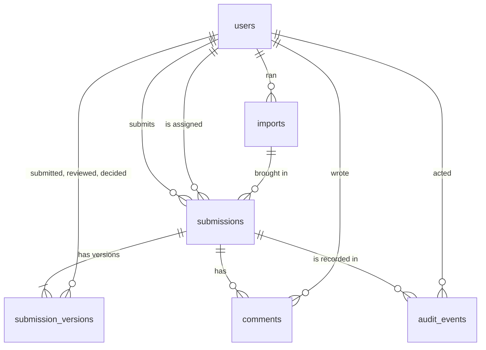

# Data model

Six tables in Postgres. The schema is defined in [`src/db/schema.ts`](../src/db/schema.ts)
and created by the migrations in [`drizzle/`](../drizzle). This page explains
what each table holds and why it's shaped the way it is.

| Table | One row per | Changes after it's written? |
| --- | --- | --- |
| `users` | Person on the marketing or compliance team | Rarely |
| `submissions` | Piece of marketing under review, holding its current state | Yes, as the review moves |
| `submission_versions` | Revision of the copy and how its round of review went | Only to record pickup and decision |
| `comments` | Comment, decision note or resubmission note | Never |
| `imports` | Spreadsheet or email brought in from the old process | Never |
| `audit_events` | Thing that happened | Never, enforced by the database |

## Conventions

- **Names.** Columns are snake_case in Postgres and camelCase in TypeScript;
  Drizzle converts between them, so neither side compromises.
- **Times.** Every timestamp is `timestamptz`: an exact moment, stored in UTC
  and shown in Eastern time. Daylight-saving changes can't shift history, and
  "how long did this take" is simple subtraction.
- **Dates.** A launch date is a plain `date`, because a launch is a day, not an
  instant.
- **Fixed vocabularies are database enums**: role, product line, channel,
  status, risk level, decision outcome, comment kind and import kind. The
  database rejects anything else, whatever the application sends. They're
  generated from the same lists the app uses (`src/domain/types.ts`), so the two
  can't drift.
- **Identifiers.** Business records use random UUIDs, so ids reveal nothing
  about volume or order. People have readable ids (`u_dana`), so seed data and
  audit downloads stay legible. Audit events count up (`bigserial`), because
  their order is the point.
- **Nothing is deleted.** There's no delete in the app and no cascading delete
  in the schema. Foreign keys refuse to remove anything that's still referred
  to, so history can't be orphaned.

## `users`

| Column | Type | Notes |
| --- | --- | --- |
| `id` | text, primary key | Readable id such as `u_priya` |
| `name` | text | |
| `email` | text, unique | Used to match people in imports. Never sent to the browser in import screens |
| `role` | enum `role` | `submitter`, `reviewer` or `compliance_lead` |
| `title`, `team` | text | Shown next to names so people know who they're dealing with |
| `created_at` | timestamptz | |

**Why so small:** sign-in is handled elsewhere (a demo picker now, the
company's identity provider later), so there are no passwords or tokens here.
The role is read from this table on every request, so a role change takes
effect immediately, not when the person's sign-in expires.

## `submissions`

The asset under review and where it stands now.

| Column | Type | Notes |
| --- | --- | --- |
| `id` | uuid, primary key | |
| `reference` | text, unique | `MKT-1001`, `MKT-1002`, … from a database sequence starting at 1001. What people say out loud and search by |
| `title` | text | 4–120 characters, checked in the app |
| `product_line` | enum | `personal_loan`, `credit_card`, `mortgage_prequal` |
| `channel` | enum | `email`, `landing_page`, `social`, `direct_mail`, `display_ad` |
| `target_launch_date` | date | |
| `status` | enum `submission_status` | `submitted` (shown as "Awaiting review"), `in_review`, `changes_requested`, `approved`, `rejected` |
| `submitter_id` | text → users | |
| `assignee_id` | text → users, nullable | Empty until someone starts or is assigned |
| `current_version` | integer | At least 1 |
| `risk_score`, `risk_level` | integer, enum | Copied from the current version. Score is 0–100 |
| `sla_due_at` | timestamptz | The current review deadline, copied from the current version |
| `created_at`, `updated_at` | timestamptz | |
| `closed_at` | timestamptz, nullable | Set when approved or rejected |
| `import_id` | uuid → imports, nullable | Set only for reviews brought in from a tracker or email |
| `source_label` | text, nullable | Where it came from, in words: `“Q3 tracker.xlsx” · row 12` |
| `source_fingerprint` | text, unique, nullable | SHA-256 of what identifies the original, so it can't be imported twice |

**Constraints:** `risk_score BETWEEN 0 AND 100`; `current_version >= 1`.

**Indexes:** `status`, `assignee_id`, `submitter_id`, `import_id`, plus the
unique `reference` and `source_fingerprint`.

**Why the current state is copied here.** The queue is the screen people live
in. It filters by status, reviewer, product and risk and sorts by deadline,
risk, launch date or last update. Keeping those values on the submission
means one table answers the queue, with no join to the latest version and no
"latest row per group" query. The cost is that two places must agree; the
service layer always updates both in the same transaction, and the versions
remain the source of truth for history.

**Why a human reference as well as a UUID.** People say "MKT-1017" on calls
and in emails. The UUID stays internal, and the reference is what appears in
web addresses, search and downloads.

**Why the fingerprint is unique in the database.** Two people importing the
same tracker at the same moment would both pass the app's duplicate check. The
unique constraint makes the second one fail, and the app turns that failure into
"brought in by someone else a moment ago."

## `submission_versions`

Every revision of the copy, its pre-check result and how its round of review
went.

| Column | Type | Notes |
| --- | --- | --- |
| `id` | uuid, primary key | |
| `submission_id` | uuid → submissions | |
| `version` | integer | 1, 2, 3, … |
| `body` | text | The copy exactly as submitted, up to 8,000 characters |
| `findings` | jsonb | The pre-check's findings for this copy: rule, severity, citation, message, suggested fix and where in the text it matched |
| `risk_score`, `risk_level` | integer, enum | |
| `engine_version` | text | Which version of the rules produced the findings, e.g. `2026.10.3` |
| `note` | text, nullable | The submitter's note on what changed |
| `submitted_by_id`, `submitted_at` | text → users, timestamptz | |
| `sla_due_at` | timestamptz | This round's review deadline |
| `review_started_at`, `reviewer_id` | timestamptz, text → users | Set when a reviewer starts |
| `decided_at`, `decided_by_id`, `outcome` | timestamptz, text → users, enum | `approved`, `changes_requested` or `rejected` |

**Constraints:** unique `(submission_id, version)`; `outcome` and `decided_at`
are either both set or both empty, so a decision can't exist without a time or
the other way round.

**Why a row per version, not an edit history on one row.** A version is a
review round: copy, findings, deadline, who picked it up, who decided and when.
Keeping each round whole is what makes the tracked-changes view, "fixed since
version 1", per-round deadlines and the dashboard's stage timings simple and
exact.

**Why findings are stored, not recomputed.** The record has to show what the
reviewer saw when they decided. If a rule changes next month, old versions keep
their original findings, and `engine_version` says which rules produced them.

**Why findings are JSON, not their own table.** Findings are always read with
their version and never updated or queried one by one. The one place that
counts them across submissions (the dashboard's most common findings) does so
over first versions only, which is small. A separate table would add a join to
every review page for no gain at this size. If finding-level reporting grows,
a `GIN` index or a findings table can be added without changing what's stored.

## `comments`

| Column | Type | Notes |
| --- | --- | --- |
| `id` | uuid, primary key | |
| `submission_id` | uuid → submissions | |
| `version` | integer | Which version the comment is about |
| `author_id` | text → users | |
| `kind` | enum `comment_kind` | `comment`, `decision` (the reason given with a decision) or `resubmission` (the submitter's note) |
| `body` | text | Up to 2,000 characters |
| `created_at` | timestamptz | |

**Index:** `(submission_id, created_at)`, the order the discussion is shown in.

**Why decision notes live here too.** The submitter reads one conversation:
comments, the reviewer's reasons and their own resubmission notes, in order.
The `kind` column lets each be styled differently without three tables.

## `imports`

One row per spreadsheet or email brought in from the old process.

| Column | Type | Notes |
| --- | --- | --- |
| `id` | uuid, primary key | |
| `kind` | enum `import_kind` | `spreadsheet` or `email` |
| `file_name` | text, nullable | Cleaned file name; empty when an email was pasted |
| `file_sha256` | text, nullable | Fingerprint of the file's contents |
| `imported_by_id` | text → users | |
| `imported_at` | timestamptz | |
| `submission_count` | integer | How many reviews it created |

**Indexes:** `imported_at` (recent imports list), `file_sha256` (re-upload check).

**Why a table for imports at all.** Every imported review points back to its
import, so anyone can see where a record came from and who brought it in. The
file fingerprint lets the app say "you imported this exact file on Oct 6"
before listing every row as a duplicate. The original files aren't kept: the
rows they produced are the record, and storing uploads would mean storing
whatever else was in them.

## `audit_events`

The permanent record of everything that happened.

| Column | Type | Notes |
| --- | --- | --- |
| `id` | bigserial, primary key | Counts up, so order is unambiguous |
| `occurred_at` | timestamptz | |
| `actor_id` | text → users, nullable | Empty when Review Hub acted on its own (for example, the pre-check) |
| `actor_role` | enum `role`, nullable | The person's role *at the time*. Roles change; history shouldn't |
| `action` | text | One of a fixed list of event types (below) |
| `submission_id` | uuid → submissions, nullable | |
| `reference` | text, nullable | The review number, copied so a download reads on its own |
| `summary` | text | A plain sentence, such as "Dana Okafor assigned Alana Torres" |
| `details` | jsonb | Event-specific facts, such as old and new reviewer or the risk score |
| `session_id` | text, nullable | Which sign-in session did it, for tracing |

**Indexes:** `occurred_at` (newest first, and date filters), `submission_id`
(each review's timeline), `action` (the event filter).

**Event types:** signed in, signed out, submitted, brought in (imported),
resubmitted, tracker imported, pre-check ran, reviewer assigned, review
started, commented, approved, changes requested, rejected, audit exported.
The list is defined once in `src/domain/audit.ts`.

**Why it can't be changed.** The audit trail is evidence for examiners. Migration
`0001_audit_append_only.sql` adds triggers that make the database refuse any
`UPDATE`, `DELETE` or `TRUNCATE` on this table, whatever the application does.
A bug, a bad script or a compromised app server can add events but can't
rewrite them. The only exception is resetting the demo: `npm run db:seed`
switches off the truncate trigger inside its own transaction to start fresh,
and that requires the database owner's permissions. In production the app
would connect as a role that can only insert and read this table (see
[SECURITY.md](../SECURITY.md)).

**Why `action` is text, not an enum.** Adding a value to a Postgres enum is a
schema change, and this is the one table we never want to alter. The fixed
list is enforced in TypeScript instead, where the type system makes sure every
event type has a label and an icon.

**Why the reference and role are copied.** A downloaded audit file has to make
sense on its own, years later, without joining back to tables whose rows may
have changed since.

**Why the audit event is written in the same transaction as the change.** If
the change is saved, its event is saved; if either fails, neither is. There's
no window where something happened but wasn't recorded.

## Sequence

`submission_reference_seq` starts at 1001 and feeds `submissions.reference`.
Sequences never hand out the same number twice, even under concurrent inserts,
so references are unique without a retry loop. Gaps are possible (a failed
insert uses a number) and harmless.

## Migrations

| File | What it does |
| --- | --- |
| `0000_init.sql` | Enums, the reference sequence and the first five tables |
| `0001_audit_append_only.sql` | The triggers that make `audit_events` permanent |
| `0002_imports.sql` | The `imports` table and the provenance columns on `submissions` |

Change `src/db/schema.ts`, run `npm run db:generate` to write the next
migration, read the SQL it produced, then `npm run db:migrate`.

## What we chose not to model

| Not modelled | Why |
| --- | --- |
| A company or team id on every row | One compliance team. Adding it later is a column and a filter in the query layer |
| Soft deletes (`deleted_at`) | Nothing is deleted. Copy that shouldn't run is rejected with a reason, which is what an examiner wants to see |
| Stored files (images, PDFs, uploaded trackers) | Copy is stored as text. Uploads are read, checked and discarded |
| Settings tables (deadlines, rules) | Defaults live in code, tested and versioned. See [DECISIONS.md](DECISIONS.md#no-settings-page) |
| Full-text search index | The queue searches asset names and review numbers, and the audit trail searches summaries and review numbers. Both are fast at this volume; a trigram index is the next step if they aren't |
| Event sourcing (rebuilding state from audit events) | The audit trail records what happened for people; the tables hold current state for the app. Making one depend on the other would make both harder to change |
