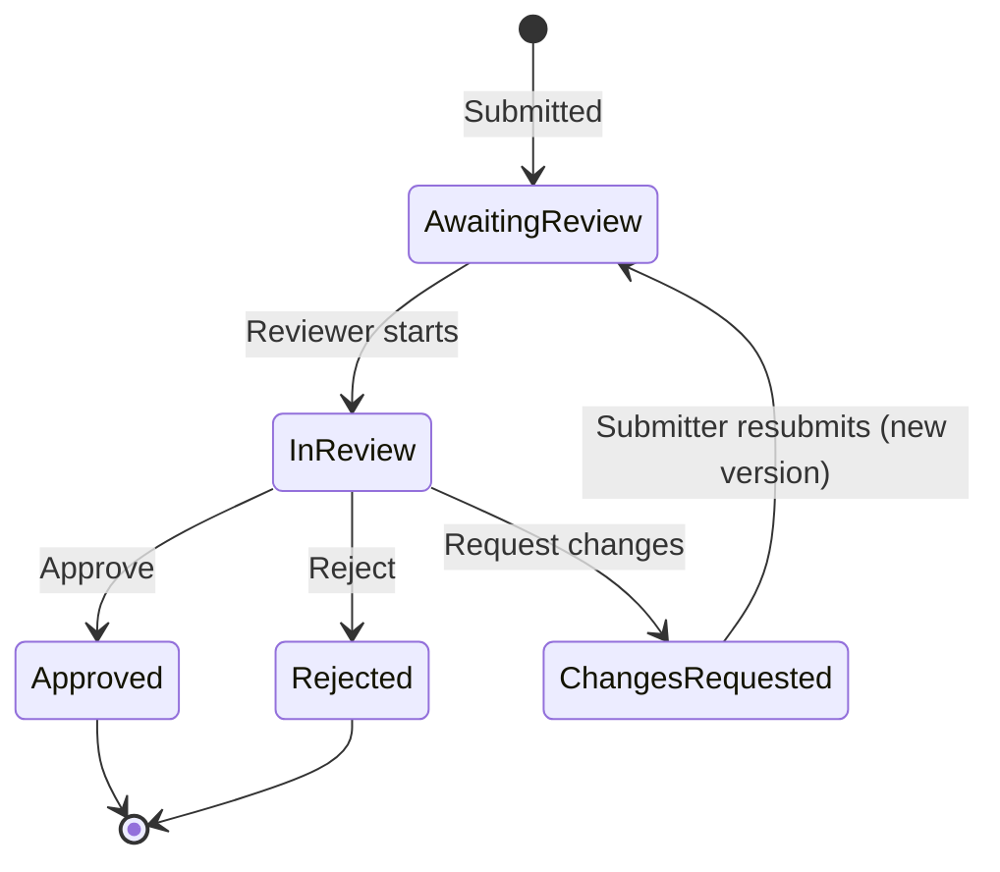

# Decisions

The assumptions behind Review Hub and the choices we made, with the
alternatives we turned down. When something here changes, update the entry
rather than adding a contradicting one.

- [Assumptions](#assumptions)
- [Stack](#stack)
- [Architecture](#architecture)
- [Product and workflow](#product-and-workflow)
- [Imports](#imports)
- [Design and accessibility](#design-and-accessibility)

The database tables have their own document: [DATA-MODEL.md](DATA-MODEL.md).

---

## Assumptions

Things we took as given because the brief didn't say, or because a demo can't
know them. Each one is easy to revisit; where it's encoded is listed so a change
is one edit, not a hunt.

### The company and its people

| Assumption | Where it lives |
| --- | --- |
| ClearPath Financial is a fictional US consumer lender with three product lines: personal loans, credit cards and mortgage pre-qualification | `src/domain/types.ts` |
| Marketing publishes on five channels: email, landing pages, social posts, direct mail and display ads | `src/domain/types.ts` |
| One compliance team: three reviewers (a generalist, a mortgage specialist, a card specialist) and one Compliance Lead, serving three marketers | `scripts/seed-data.ts` |
| The team works in US Eastern time. Every date and time on screen and in downloads is Eastern, whatever the viewer's own time zone | `src/lib/dates.ts` |
| Three roles are enough: Submitter, Reviewer, Compliance Lead. A Compliance Lead can do everything a reviewer can, plus assign work and download the audit trail | `src/domain/permissions.ts` |
| Users aren't technical. Nothing on screen should need an explanation of how the system works | Throughout |

### The review process

| Assumption | Where it lives |
| --- | --- |
| A review is about the words: subject line, body and fine print. Images and layout are reviewed outside the tool for now | `src/lib/validation.ts` (copy is 20–8,000 characters) |
| Each round of review has one outcome: approve, request changes or reject. Request changes sends it back to the submitter; the other two close it | `src/domain/workflow.ts` |
| Rejected means "can't run in any form". Fixable problems get "request changes" instead, so a rejected submission can't be resubmitted | `src/domain/workflow.ts` |
| Nobody reviews their own copy, including the Compliance Lead | `src/domain/permissions.ts` |
| Any reviewer may pick up unassigned work. Once someone is assigned, only they or the Compliance Lead can start or decide it | `src/domain/permissions.ts` |
| A decision to request changes or reject must say why (at least 15 characters), because the submitter needs to know what to do next | `src/lib/validation.ts` |
| Approving copy that still has high-severity findings is allowed (the rules can't see a disclosure that lives on another page) but needs a written reason for the record | `src/lib/validation.ts`, `src/server/services/submissions.ts` |

### Deadlines

| Assumption | Where it lives |
| --- | --- |
| Riskier copy gets a *shorter* deadline: 48 hours for high risk, 72 for medium, 120 for low. High-risk copy is the most likely to block a launch and the most expensive to get wrong, so it shouldn't wait | `src/domain/sla.ts` |
| Deadlines are calendar hours, not business hours. Simple to explain and to audit; holiday calendars are a later refinement | `src/domain/sla.ts` |
| The deadline is counted from when the version was submitted. Each resubmission starts a new deadline, and the clock is shown as paused while work is back with marketing | `src/domain/sla.ts` |
| "Due soon" means within 12 hours | `src/domain/sla.ts` |
| A launch is at risk when the review deadline falls on or after the start of launch day. Launch dates have no time, so "start of the day" is taken as midnight UTC (8 PM Eastern the evening before in summer), which warns slightly early rather than late | `src/domain/sla.ts` |
| Launch dates must be today or within the next 365 days | `src/lib/validation.ts` |

### The pre-check

| Assumption | Where it lives |
| --- | --- |
| A rules-based check can reliably catch the recurring, mechanical problems (a rate without an APR, "guaranteed approval", a missing NMLS ID). It can't judge context, so it advises and the reviewer decides | `src/domain/precheck/` |
| Sixteen rules cover the common cases across Truth in Lending (Reg Z), fair credit reporting, mortgage advertising, fair lending and unfair or deceptive claims. Each rule applies only to the products it's relevant to | `src/domain/precheck/rules.ts` |
| Risk score: 30 points per high finding, 15 per medium, 5 per low, capped at 100. 50 or more is high risk, 20 or more medium. So one high finding alone is medium risk; two make it high | `src/domain/risk.ts` |
| The rules change rarely and only after legal review, so they live in code with tests, not in a settings screen | `src/domain/precheck/rules.ts` |

### Imports

| Assumption | Where it lives |
| --- | --- |
| Every team's old tracker is laid out differently, and guessing at columns would quietly put wrong data into a compliance record. So we accept one documented layout and explain exactly what to change | `src/domain/import/tracker.ts` |
| 500 reviews and 2 MB per file is plenty for a tracker; bigger histories split into several files | `src/domain/import/`, `src/lib/spreadsheet/` |
| Dates in trackers are written US-style (month/day/year) in Eastern time. A date without a time means midday | `src/domain/import/tracker.ts` |
| Everyone named in a tracker or email is already in Review Hub. Imports never create accounts | `src/server/services/imports.ts` |
| Review request emails come from marketing. An email from someone on the compliance team isn't a review request | `src/server/services/imports.ts` |
| Only the compliance team imports, because an import records who submitted and who decided on other people's behalf | `src/domain/permissions.ts` |

### Hosting and the demo

| Assumption | Where it lives |
| --- | --- |
| The demo is public and holds only fictional data, so anyone can sign in as any sample employee without a password | `src/server/session.ts` |
| One deployment region. The rate limiter keeps its counts in memory, which is enough for one region and a demo | `src/lib/rate-limit.ts` |
| Vercel hosts the app and Neon hosts Postgres | `README.md` |

---

## Stack

### Next.js 16 with the App Router and server actions

**Why:** One project serves the pages and handles the forms. Pages render on
the server, so people see real content on the first load and the browser never
receives data it isn't allowed to see. Server actions turn each form into a
typed function call, with no separate API to design, version and secure.

**Instead of:** a single-page app plus a separate API (Express, NestJS). That
means two deployments, an API surface to secure twice, and data-fetching code in
the browser. Remix and SvelteKit were reasonable too; Next.js is what Vercel
runs best, and the team is most likely to know it.

**Notes:** Next 16 renames middleware to `src/proxy.ts`, which sets the
security headers and redirects signed-out visitors. Cache Components is
deliberately off: the security policy needs a fresh random value (a nonce) in
every page, which a pre-built page shell can't carry.

### TypeScript, strict

**Why:** The workflow states, roles, products and channels are closed lists.
TypeScript makes it a compile error to forget one (for example, adding an audit
event without a label for it).

### PostgreSQL, hosted on Neon

**Why:** The data is relational (people, submissions, versions, comments) and
the record has to be trustworthy, which is what a relational database is for:

- Constraints the database itself enforces: risk scores between 0 and 100, a
  decision always has a date, review numbers are unique.
- Transactions and row locks, so two reviewers deciding the same review at the
  same moment can't both win.
- Triggers, which make the audit trail impossible to edit or delete, even for
  the app itself.

Neon is serverless Postgres with a first-class Vercel integration that creates
the database and its connection settings in one step.

**Instead of:**

- MongoDB or Firestore: no foreign keys, check constraints or triggers, so the
  integrity rules would live only in application code.
- SQLite: there's no persistent disk on Vercel's serverless functions.
- Supabase: also Postgres and a fine choice, but it bundles authentication and
  storage we don't use, and Neon is the integration Vercel offers.

### Drizzle ORM with postgres.js

**Why:** Drizzle reads like SQL, gives typed results, has no query engine to
start on each serverless cold start, and produces plain SQL migrations we can
read and edit. The audit trail's protection is a hand-written trigger in
migration `0001`.

**Instead of:** Prisma (a heavier client and less direct control over the SQL);
Kysely (a good query builder but no schema or migrations); raw SQL (no types).

**Notes:** `prepare: false` because Neon's connection pooler doesn't support
prepared statements. Up to five connections per server instance. Migrations
and the seed use the direct (unpooled) connection, because schema changes and
long transactions don't belong on a pooler.

### Zod for every input

**Why:** Server actions are public endpoints, so every field is checked on the
server whatever the form allowed. One schema gives both the check and the
message shown next to the field.

### jose for the sign-in cookie

**Why:** A small, standards-based library for signed tokens that works in every
runtime Next.js uses. The token is signed with HS256, its algorithm, issuer and
audience are checked, and it expires after 8 hours.

**Instead of:** Auth.js / NextAuth (built for real identity providers; the demo
has none, and the production path is a single OIDC callback, described in
[SECURITY.md](../SECURITY.md)); iron-session (fine, but encrypts rather than
signs, and the cookie holds nothing secret).

### Tailwind CSS 4 with our own components

**Why:** Fast to build with and easy to keep consistent, with no component
library look. Review Hub has its own small set (button, card, field, notice,
page header) designed for this product.

**Instead of:** shadcn/ui, MUI or Chakra. They're quick to start with, but
apps built on them tend to look alike, and the brief asked for something that
doesn't look generic.

**Notes:** Type is IBM Plex Sans for the interface, IBM Plex Mono for review
numbers and figures, and Newsreader (a serif) for marketing copy, so copy under
review reads like a document rather than a form field. Fonts are served from the
app itself, not from Google, so no third party sees who uses it.
Icons are Lucide.

### A hand-written rules engine, not AI

**Why:** A compliance tool has to explain itself. Each rule is a short,
readable function with a legal citation, a message and a suggested fix. The same
copy always gets the same result, every result records which version of the
rules produced it (currently `2026.10.1`), and every rule has tests. No
marketing copy leaves the system.

**Instead of:**

- A large language model: results vary from run to run, are hard to explain to
  an examiner, and send unreleased copy to a third party.
- Rules written as configuration (JSON or a rules language): only worth it once
  non-developers maintain rules, and much less expressive.

### Small, focused libraries

| Library | Used for | Chosen over |
| --- | --- | --- |
| `diff` | The word-by-word tracked-changes view between versions | Writing a diff algorithm |
| `fflate` | Reading and writing Excel files (an .xlsx file is a zip of XML) | SheetJS (its current builds are distributed outside npm and it's far larger), ExcelJS (much larger, built for Node streams) |
| `postal-mime` | Reading a saved email (.eml) in the browser, so the email itself is never uploaded | Parsing on the server, which would mean storing whole emails, attachments included |
| `lucide-react` | Icons | |
| `clsx`, `tailwind-merge` | Combining class names | |

### Vitest and Playwright

**Why:** Vitest runs the unit tests (265 of them, mostly on the business rules
in `src/domain/`) in under a second. Playwright signs in as each role and checks
that every page fits at five screen sizes, and regenerates the README
screenshots.

### Vercel, with configuration in Vercel's environment variables

**Why:** Vercel builds and deploys on every push, gives each change a preview
link, and there are no servers to manage. There are only
three settings (the session secret and two database addresses), and they live
in Vercel's encrypted environment variables.

**Instead of:**

- Kubernetes: a cluster to run and secure, for an app that needs none of it.
- Keeping settings in a database table: the database address can't live in the
  database it unlocks, and a secret stored in a table means anyone who reads the
  database can forge sign-ins.
- Committing them to the repository: anyone with read access would have them.
  Only `.env.example`, with empty values, is committed.

---

## Architecture

### Three layers: decide, enforce, present

- `src/domain/` holds the business rules as plain functions with no database
  or framework: the workflow, permissions, deadlines, risk score, metrics,
  pre-check rules and import checks. This is where most tests live.
- `src/server/` enforces them. Actions check the request and the input;
  services do every write; queries do every read, limited to what the signed-in
  person may see.
- `src/app/` and `src/components/` present the result.

A rule written once in `domain/` applies to the form, the server, the import and
the seed script alike.

### Every write follows the same steps

1. Check the request came from Review Hub itself and isn't arriving faster
   than a person would send it.
2. Look up who is signed in. Their role is read from the database on every
   request, never from the cookie.
3. Validate the input.
4. Open a transaction and lock the submission's row.
5. Check permission and the workflow rules against the locked row, so a
   decision made a second earlier by someone else is seen.
6. Write the change and its audit event in the same transaction: either both
   are saved or neither is.

### Authorization on the server, for reads too

Every page and action asks the permission policy in `src/domain/permissions.ts`.
The UI uses the same policy only to decide what to show. A submitter who types
another person's review address gets "not found", not someone else's copy.

### Current state stored next to its history

A submission row holds its current status, risk, deadline and reviewer, copied
from its latest version. The queue sorts and filters on one table, and the
versions keep the full history. The service layer updates both in one
transaction. Details in [DATA-MODEL.md](DATA-MODEL.md).

### Errors that help without revealing anything

Problems the person can fix (a missing field, a review someone else just
decided, a file that doesn't match the template) carry a plain message saying
what to do. Anything unexpected is logged on the server and shown as
"Something went wrong on our side. Nothing was saved." No error ever includes
database messages, file paths or technical detail.

### No settings page

The team asked for a tool that works the moment it's opened. Deadlines, rules
and limits are sensible defaults in code, versioned and tested, rather than
switches someone has to understand and maintain.

---

## Product and workflow

### The review cycle

Statuses on screen are "Awaiting review", "In review", "Changes requested",
"Approved" and "Rejected". Any other move is refused by the server
(`src/domain/workflow.ts`).

### Words on screen

Internal terms are replaced with the team's own words:

| Internal | On screen |
| --- | --- |
| SLA | Review deadline |
| v2 | Version 2 |
| Claim | Start review |
| Persona | Person |
| Audit export (CSV) | Download for Excel |
| System actor | Review Hub (automatic) |

A final pass over the remaining technical wording is in progress (see
[PLAN.md](PLAN.md#delivery)).

### What reviewers see first

The queue opens sorted by deadline, with overdue rows marked by a hatched edge
and counts for overdue, due soon, launch at risk and unassigned at the top.
Each review opens on the copy, with findings numbered in the text and listed
with the rule, the regulation behind it and a suggested fix.

### Marketing sees the pre-check while writing

The same rules run in the browser as the submitter types, with the score and
findings updating live. The server re-runs the check on submit, so the browser
version is a preview, never the record.

---

## Imports

The switch from Excel and email shouldn't start from an empty system. The user
guide is [IMPORTING.md](IMPORTING.md); the decisions behind it:

- **One strict template.** Column names on row 1, exactly as in the template,
  on a tab named "Reviews" (or the first tab). The template has dropdowns for
  every fixed choice, so most mistakes can't be typed in the first place.
- **Check, then preview, then save.** Nothing is written until the person has
  seen exactly what will be created. Every problem is listed by row and column
  with what to change.
- **All or nothing.** If any row has a problem, nothing is imported. Half an
  import is harder to fix than none.
- **No duplicates.** Each imported review stores a fingerprint of what
  identifies it (a tracker row's asset name, submission date and copy, or an
  email's message ID), and each file stores a fingerprint of its contents. Importing the same file or email
  twice is caught and explained, even if two people try at the same moment.
- **Open reviews keep their real deadlines,** counted from when they were
  originally submitted, so imported overdue work shows as overdue.
- **Closed reviews become history.** They count toward the dashboard and show
  in the audit trail, marked as brought in.
- **Emails are read in the browser.** A saved .eml file or pasted text is
  separated into the request and the copy on the person's own computer. Only
  the fields they confirm (the copy, subject, sender and time) are sent, never
  the email itself or its attachments.

---

## Design and accessibility

### A look of its own

The brief asked for something that doesn't look generic. Review Hub uses a
paper-and-ink palette with a deep green brand colour, a serif for the copy
under review, monospaced figures for review numbers and deadlines, and a
hatched edge for overdue work. Colour is never the only signal: every status
and deadline is also written out in words, and every risk has its score.

### Fits every screen

- Below 1280 pixels wide, the queue and audit trail switch from tables to
  cards, so nothing scrolls sideways on a phone, tablet or small laptop.
- Pages use the full width of the screen. On large monitors, text and spacing
  grow gradually (16 px up to a 1920 px screen, 18 px from 2400 px), and side
  panels take a share of the width rather than a fixed size.
- `npm run test:layout` signs in as each role and checks every page at phone
  (390 px), tablet (768), laptop (1280), desktop (1920) and wide (2560) sizes,
  failing if anything is cut off or scrolls sideways.

### Accessible to everyone

- A "Skip to content" link, labelled regions and headings in order.
- Every control works from the keyboard, with a visible focus ring.
- Form errors are announced and tied to their field.
- Charts have an equivalent table for screen readers.
- Animation is reduced for people who ask their device for less motion.
